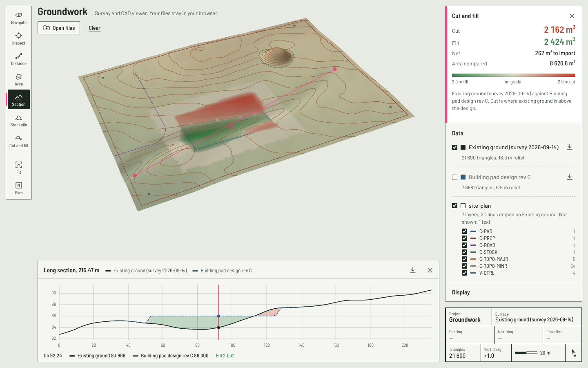
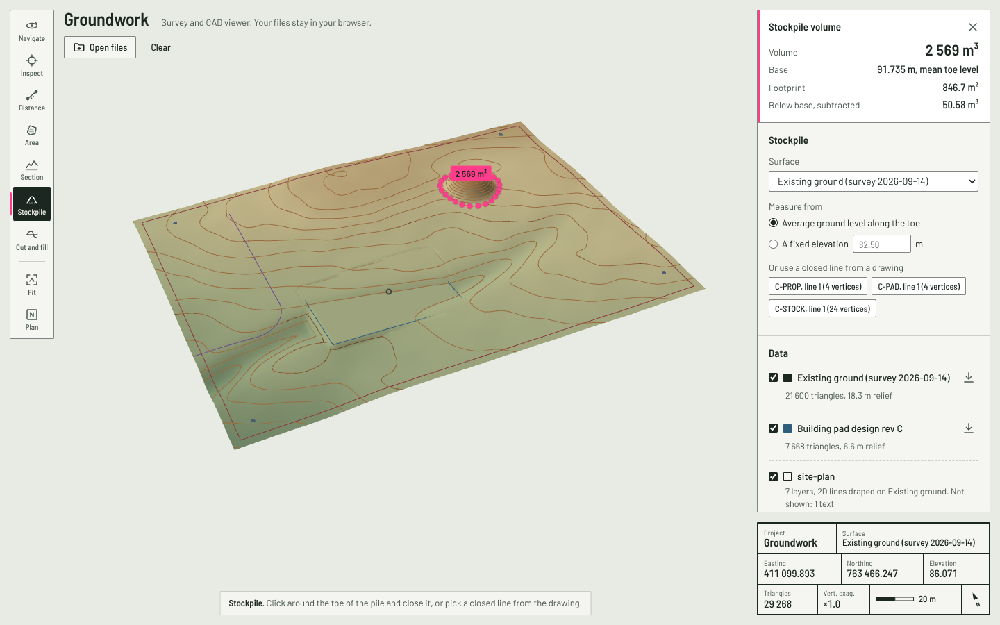
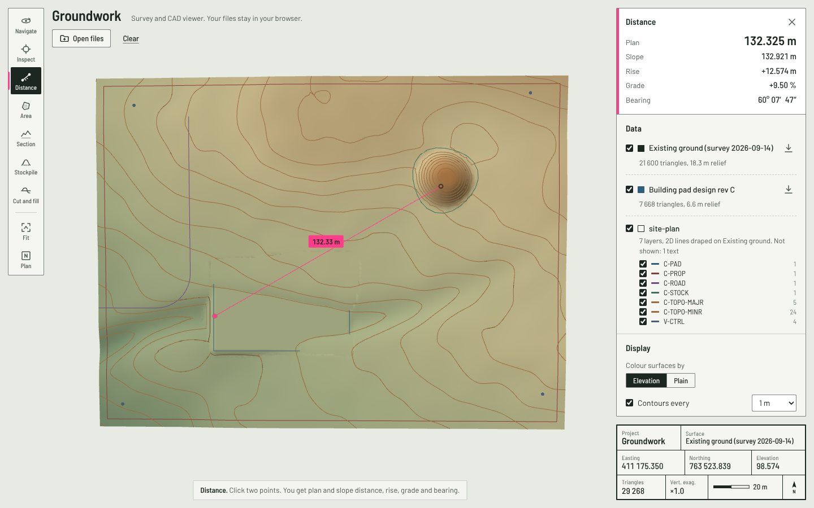

# Groundwork

Open survey and CAD data in the browser and measure it: LandXML terrain, DXF site plans, distances, areas, long sections, stockpile volumes and cut/fill against a design. Nothing is uploaded; files are read and processed on your machine.

**Live demo: [groundwork demo](https://groundwork-3d.onrender.com)** (opens with a synthetic site already loaded: rolling ground with a stockpile, a building pad design and a CAD site plan)



## What it does

| | |
|---|---|
| **Open** | LandXML 1.x TIN surfaces and ASCII DXF (lines, LW/2D/3D polylines with arcs, arcs, circles, points, 3D faces). Drag files onto the page or use *Open files*. |
| **See** | Hillshaded terrain with elevation colouring, contours at any interval, the triangle mesh, drawing layers you can switch on and off, vertical exaggeration, oblique and plan views. |
| **Measure** | Plan and slope distance, rise, grade and bearing. Plan area and perimeter. Elevation of every loaded surface under a point. |
| **Section** | Cut a long section along any line through every surface, with cut and fill shaded between existing and design. Point at the chart to find the spot in 3D. Download as CSV. |
| **Stockpile** | Volume above the average toe level or a fixed base, from a boundary you click or a closed line in the drawing. |
| **Cut and fill** | Existing vs design totals (cut, fill, net) and a cut/fill heat map on the ground. |
| **Export** | Contours as DXF, split into major and minor layers. |

<p>
  
  
</p>

## How it works

The interesting parts are about keeping survey numbers correct while rendering them fast.

**Coordinates stay in float64 until the GPU.** Survey data sits at coordinates like E 411 020.373, N 763 528.271. In float32 the spacing between representable values at 763 528 is 6.25 cm, so vertices snap, lines shimmer and picks are off by centimetres. Groundwork keeps every coordinate in `Float64Array`s for parsing, measurement and volumes, and only shifts to a local origin and narrows to float32 when building GPU buffers ([`core/origin.ts`](src/core/origin.ts)). Picks come back through the same origin, so the coordinates you read are the file's coordinates.

**Volumes against a plane are exact.** Over a triangle, height above a plane is linear, so the prism volume is plan area times mean corner height. Triangles that cross the plane are clipped so cut and fill never cancel each other ([`core/volume.ts`](src/core/volume.ts)). Surface-to-surface cut/fill and volumes inside a drawn boundary are sampled on a grid sized to the job; the tests check the grid result against the exact one.

**A spatial index answers "how high is the ground here?" in constant time.** Sections, volumes, draping and the heat map make hundreds of thousands of these queries. [`TinIndex`](src/core/tinIndex.ts) buckets triangles into a uniform grid stored as two flat arrays (CSR), and checks the last triangle hit first, so walking along a line or a grid row barely touches the index. A million lookups take about 0.2 s.

**Heavy work runs in a Web Worker.** Parsing, contouring, sections and volumes run in [`engine.worker.ts`](src/engine/engine.worker.ts) behind a small typed RPC, so the 3D view never stalls. The [`Engine`](src/engine/engine.ts) is a plain class, so the tests drive it directly without a browser.

**The 3D view renders only when something changes.** Picking uses a BVH ([three-mesh-bvh](https://github.com/gkjohnson/three-mesh-bvh)). Contours come from marching triangles on the TIN itself, with no regridding. 2D linework drawn at z = 0, as most site plans are, is draped onto the ground and split where it leaves the surface instead of diving 80 m under it.

```
src/
  core/      geometry, local origin, TIN index, volumes, contours, sections, demo site generator
  formats/   LandXML and DXF parsers, LandXML and DXF writers
  engine/    analysis engine, worker, typed RPC client
  viewer/    three.js scene: surfaces, linework, contours, picking, overlays
  ui/        React app, title block, section chart, formatting
```

## Correctness

The tests check results against answers known in advance rather than snapshots of whatever the code produced:

- a 10 × 10 m block 3 m high is 300 m³; a tilted plane gives two 125 m³ wedges;
- a cone's grid volume is within 0.5 % of the exact TIN volume, and the TIN within 1 % of πr²h/3;
- a DXF bulge of 1 is a semicircle on the correct side, and a written arc reads back onto its circle;
- LandXML points are read as *northing easting elevation*, and invisible faces are skipped;
- float32 really does lose the millimetres that the local origin keeps;
- the demo files are byte-for-byte reproducible from the seeded generator, which CI checks.

```bash
npm test          # 40 tests
npm run bench     # timings on the demo site
```

| Demo site (21,600 + 7,668 triangles) | Time |
|---|---|
| Parse existing ground, LandXML 1.3 MB | 260 ms |
| Cut/fill, existing vs design | 120 ms |
| Contours at 0.5 m | 9 ms |
| 1,000,000 elevation lookups | 200 ms |

<sub>Node 22, one core of a cloud VM. In the browser this all runs in the worker.</sub>

## Run it

```bash
npm install
npm run dev       # http://localhost:5173
npm run build     # static site in dist/
npm run samples   # regenerate public/samples from src/core/sample.ts
```

Keyboard: `V` navigate, `I` inspect, `D` distance, `A` area, `P` section, `S` stockpile, `C` cut and fill, `Enter` finish a shape, `Backspace` remove the last point, `Esc` clear.

## Limits

DXF must be ASCII (R12 or later). Blocks, text and hatches are counted and listed rather than drawn. LandXML surfaces need faces; point-only surfaces are not triangulated. Files up to 150 MB are accepted, since everything runs in the browser.

## About the demo data

The demo site is generated by [`src/core/sample.ts`](src/core/sample.ts): seeded noise for the ground, an analytic stockpile, and a pad whose 1:2 batters daylight into the existing surface. It sits in projected coordinates so the precision handling above is exercised exactly as it would be with real survey data. No client data is used anywhere in this repository.

## Licence

MIT. Built by [Tariq Ali](https://tariqali.dev).
